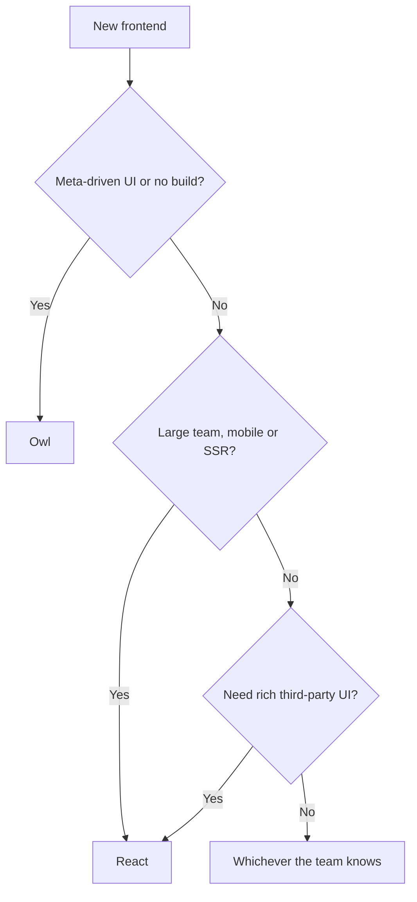

Owl and React both build screens from components and keep the screen in sync with state. They differ in what they bring with them. The useful question is not which one is better, but which one fits the situation at hand.

## Owl vs React

**Owl** is a small framework from Odoo. Components, state, hooks and templates come in one package. Templates are plain XML (QWeb), so a page can load Owl from a script tag and run with no bundler.

**React** is a rendering library. On its own it is small, but a real project adds a router, a data layer, forms and a design system from its ecosystem. JSX needs a build tool such as Vite.

## Code

The same button in both:

```js
// Owl
class Counter extends Component {
  static template = xml`
    <button t-on-click="increment">
      Clicked <t t-esc="state.count"/> times
    </button>`;
  setup() { this.state = useState({ count: 0 }); }
  increment() { this.state.count++; }
}
```

```jsx
// React
function Counter() {
  const [count, setCount] = useState(0);
  return <button onClick={() => setCount(count + 1)}>Clicked {count} times</button>;
}
```

Owl state is an object you change directly. React state is immutable and changes through a setter.

## Pros and cons

| | Owl | React |
| --- | --- | --- |
| Type | Small full framework | Library plus ecosystem |
| Build step | Optional | Practically required |
| Templates | XML, separate from logic | JSX, inside the function |
| Ecosystem | Small | Very large |
| Hiring | Hard | Easy |
| Learning curve | Small API, but few tutorials | More concepts, many tutorials |
| TypeScript and tooling | Limited for templates | First class |
| Mobile and SSR | Not built in | React Native, Next.js |

## Use Owl for meta-driven UI

A platform stores screen definitions as data. The client must load fast on weak networks, run from a static host, and keep the deploy pipeline free of a bundler.

Templates are text, so the server can store, extend and send them. Deploy is "copy the folder", and a service worker can precache the few files for offline use. Direct state changes keep forms and tables short. The Base Hub product, which I develop, uses this mechanism too.

The cost: fewer ready-made components, so some are written in-house.

## Use React for large teams

A product team builds tables, charts, role-based screens and a design system. Many developers work on it, new people join often, and a mobile app may follow.

Mature libraries cover the hard parts: TanStack Table, Recharts, shadcn/ui. TypeScript types flow from the API to the component. New hires already know the stack. Next.js can render public pages on the server, and React Native can reuse knowledge for mobile.

The cost: the team must agree early on one router, one state library and one data-fetching approach, and keep dependencies under review.

## Small internal tools

One or two developers, a handful of screens, no mobile plan. Either works. Lean Owl if no build step matters, or React if the developers already know it. At this size, familiarity beats framework features.

## Using both

A back office built as meta-driven UI, plus a public dashboard. Use Owl for the back office and React for the dashboard, with a clear API between them. Avoid sharing components across the two.

## How to choose



Choose by team size, hiring, platform plans and how screens are delivered. The framework is the smaller part of that decision.

Questions or a different experience with either one? Write to [community@thebase.vn](mailto:community@thebase.vn) or join the discussion on [GitHub](https://github.com/thebases).
