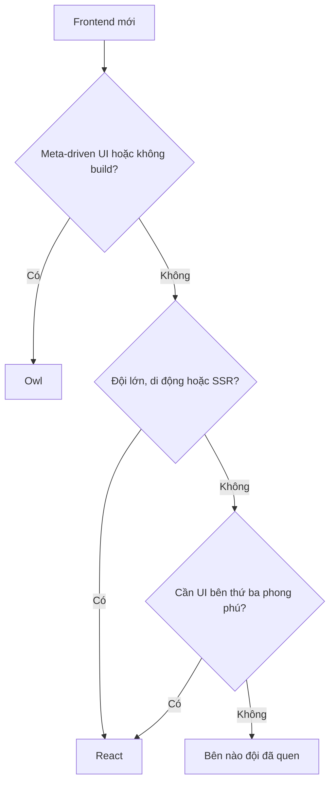

Owl và React đều dựng màn hình từ các component và giữ giao diện khớp với state. Chúng khác nhau ở thứ mỗi bên mang theo. Câu hỏi hữu ích không phải bên nào tốt hơn, mà là bên nào phù hợp với tình huống đang có.

## Owl vs React

**Owl** là một framework nhỏ của Odoo. Component, state, hook và template nằm trong một gói. Template là XML thuần (QWeb), nên một trang có thể nạp Owl từ thẻ script và chạy mà không cần bundler.

**React** là một thư viện render. Tự nó thì nhỏ, nhưng một dự án thật sẽ thêm router, lớp dữ liệu, form và design system từ hệ sinh thái. JSX cần công cụ build như Vite.

## Code

Cùng một nút trong cả hai:

```js
// Owl
class Counter extends Component {
  static template = xml`
    <button t-on-click="increment">
      Clicked <t t-esc="state.count"/> times
    </button>`;
  setup() { this.state = useState({ count: 0 }); }
  increment() { this.state.count++; }
}
```

```jsx
// React
function Counter() {
  const [count, setCount] = useState(0);
  return <button onClick={() => setCount(count + 1)}>Clicked {count} times</button>;
}
```

State của Owl là một đối tượng được sửa trực tiếp. State của React là bất biến và đổi qua hàm setter.

## Ưu và nhược điểm

| | Owl | React |
| --- | --- | --- |
| Loại | Framework đầy đủ, nhỏ | Thư viện cộng hệ sinh thái |
| Bước build | Tùy chọn | Gần như bắt buộc |
| Template | XML, tách khỏi logic | JSX, nằm trong hàm |
| Hệ sinh thái | Nhỏ | Rất lớn |
| Tuyển dụng | Khó | Dễ |
| Đường cong học tập | API nhỏ, nhưng ít tài liệu hướng dẫn | Nhiều khái niệm hơn, nhiều tài liệu hướng dẫn |
| TypeScript và công cụ | Hạn chế với template | Hỗ trợ hạng nhất |
| Di động và SSR | Không có sẵn | React Native, Next.js |

## Dùng Owl cho meta-driven UI

Một nền tảng lưu định nghĩa màn hình dưới dạng dữ liệu. Phía client phải tải nhanh trên mạng yếu, chạy được từ máy chủ tĩnh, và pipeline triển khai không có bundler.

Template là văn bản, nên máy chủ có thể lưu, mở rộng và gửi chúng. Triển khai chỉ là "chép thư mục", và service worker có thể cache sẵn vài file để dùng offline. Sửa state trực tiếp giúp form và bảng ngắn gọn. Sản phẩm Base Hub do tôi phát triển cũng sử dụng cơ chế này.

Cái giá: ít component làm sẵn hơn, nên một số phải tự viết.

## Dùng React cho đội lớn

Một đội sản phẩm xây bảng, biểu đồ, màn hình theo vai trò và design system. Nhiều lập trình viên cùng làm, người mới vào liên tục, và có thể làm thêm app di động.

Các thư viện trưởng thành lo phần khó: TanStack Table, Recharts, shadcn/ui. Kiểu TypeScript đi từ API đến component. Người mới đã biết sẵn stack. Next.js có thể render trang công khai ở máy chủ, và React Native tận dụng được kiến thức cho di động.

Cái giá: đội phải thống nhất sớm một router, một thư viện state, một cách lấy dữ liệu, và rà soát phụ thuộc thường xuyên.

## Công cụ nội bộ nhỏ

Một hai lập trình viên, vài màn hình, không có kế hoạch di động. Bên nào cũng được. Nghiêng về Owl nếu việc không cần build quan trọng, hoặc React nếu các lập trình viên đã quen. Ở quy mô này, sự quen thuộc quan trọng hơn tính năng framework.

## Dùng cả hai

Một back office chạy bằng meta-driven UI, cộng một dashboard công khai. Dùng Owl cho back office và React cho dashboard, với một API rõ ràng ở giữa. Tránh dùng chung component giữa hai bên.

## Cách chọn



Hãy chọn theo quy mô đội, việc tuyển dụng, kế hoạch nền tảng và cách màn hình được cung cấp. Framework chỉ là phần nhỏ hơn của quyết định đó.

Bạn có câu hỏi hoặc trải nghiệm khác với một trong hai? Hãy viết tới [community@thebase.vn](mailto:community@thebase.vn) hoặc tham gia thảo luận trên [GitHub](https://github.com/thebases).
