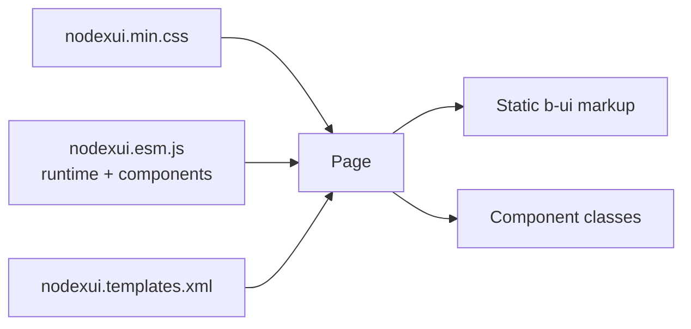

I wanted a UI library that I can drop into a plain HTML page, a Base HUB website page or a small app, without a bundler and without a second design system. I could not find one that fit all three, so I use Nodex UI. Here is what it is and where it breaks.

## Why Nodex UI

Start from the problem. A screen needs buttons, inputs, dialogs, tables and a theme. Writing them again for every project wastes time. Using a big library often brings a build tool, a router and a long list of dependencies.

My needs are small and specific:

- The page must load from a static host, with no build.
- The same look must work in plain HTML and in an app.
- Light and dark themes, and Vietnamese and English, must be easy.
- An AI agent must be able to use it without guessing.

Nodex UI is built on Owl (a small JavaScript framework from Odoo) and Bootstrap 5. Its colours and sizes follow the shadcn/ui tokens, so the look is clean and neutral. One CSS file and one JavaScript file cover everything.

I think the last point matters most. If the rules are written down and the install is one file, a person and an AI agent both make fewer mistakes.

## How it works

There are two ways to use it. Both come from the same package.

**Static markup.** You add an attribute to normal HTML. The script finds it and turns it into a component.

```html
<link rel="stylesheet" href="https://cdn.jsdelivr.net/npm/nodexui@1.3.5/dist/nodexui.min.css">
<script src="https://cdn.jsdelivr.net/npm/nodexui@1.3.5/dist/nodexui.min.js" defer></script>

<button b-ui="button" b-att-variant="default">Save</button>
<span b-icon="search"></span>
```

On page load the script scans for `b-ui` and `b-icon` and mounts them. If you add markup later, call `thebase.mountAll(root)`.

**Component classes.** For an app, you import real components and use them as tags in an Owl template.

```js
import { Component, mount, xml, Button, Card, CardBody } from "nodexui";

const templates = await fetch(import.meta.resolve("nodexui/templates")).then((r) => r.text());

class Root extends Component {
  static template = xml`
    <Card><CardBody>
      <Button variant="'default'" label="'Save'"/>
    </CardBody></Card>`;
}

await mount(Root, document.getElementById("app"), { templates });
```



Two rules cause most failures, and the docs say so:

1. Load `nodexui.templates.xml` and pass it to `mount()` before any component renders.
2. Import from `nodexui`, never from `@odoo/owl`. Otherwise two copies of `Component` exist and mounting fails.

Pin the version in production. `@latest` can change your page the day a release ships.

## What it supports

From the docs:

- **74 components**, each with both APIs: Button, Card, Dialog, Sheet, Tabs, Data Table, Date Picker, Combobox, Chart, Sidebar, Toast, Form fields and more.
- **Icons:** the full Lucide set through `b-icon`, with no extra install.
- **Themes:** `b-theme="dark"`, or `thebase.theme.set({ primary: "#0057d8" })`. A custom theme is two small CSS files that change tokens such as `--b-primary` and `--base-radius`.
- **Blocks:** ready layouts to copy, such as a dashboard, 16 sidebar variants, login and signup pages.
- **Content components:** Markdown, a rich-text editor, a code editor, DocViewer for a folder of Markdown, and ApiDoc for an OpenAPI file.
- **Optional services,** each its own small file: i18n (`.po` catalogs), cookieless analytics, and QR with the VietQR payload builder.
- **PWA toolkit:** generates `manifest.webmanifest` and a service worker, and reloads open pages on a new deploy.

Not in the list: server-side rendering and a mobile-native UI. For mobile, the docs describe wrapping the PWA in Capacitor.

## How to use AI with Nodex UI

An AI agent often invents props that do not exist. Nodex UI handles this in three ways.

**1. A skill.** The project ships `base-ui-skill.zip`. It holds a `SKILL.md` and reference pages with verified syntax, plus scripts to scaffold a project. It is plain Markdown and scripts, so it is not tied to one tool.

| Agent | Put the `base-ui/` folder in |
| --- | --- |
| Claude Code | `~/.claude/skills` or `.claude/skills` |
| Codex | `~/.codex/skills` or `.codex/skills` |
| Gemini CLI | `~/.gemini/skills` or `.gemini/skills` |

For tools without a skills folder, such as Cursor or Copilot, unzip it into the project and add one line to `AGENTS.md`: "For any NodexUI work, read and follow `base-ui/SKILL.md` first."

**2. Plain phrases.** Once installed, short requests trigger it:

| Say | Result |
| --- | --- |
| `create app` | A new NodexUI PWA |
| `use button` | A real Button component |
| `use search` | A real Lucide icon |
| `create electron app` | PWA plus an Electron shell |
| `create capacitor app` | PWA plus a Capacitor shell |

**3. Docs written for agents.** The docs folder has an `index.md` that works as one entry point, in the style of `llms.txt`. Every release also publishes `nodexui.registry.json`, which lists each component's props, events and export names. An agent reads the contract instead of guessing it.

My advice: give the agent the skill, and tell it to open the component's doc page before it writes code. I have not measured how much time this saves. `[VERIFY]` add a number if you have one.

## Some use cases

I only list what the docs describe. `[VERIFY]` mark the ones you have shipped yourself before publishing.

- **A Base HUB website page.** The page has no Nodex runtime. Two tags and `b-ui` markup give it the same look as the rest of the product.
- **A small PWA or back office.** `create-nodexui-app` scaffolds it with the manifest and service worker. Electron and Capacitor shells are optional.
- **A documentation site.** Point DocViewer at a Markdown folder and a `tree.json`. One command builds both.
- **An API portal.** Give ApiDoc an OpenAPI 3 file. It shows the sidebar, schemas, a Try It panel and an Authorize dialog.
- **A payment screen in Vietnam.** The QR service builds a VietQR payload from bank, account and amount, and draws it as SVG. I have not run this through a real bank flow, so treat it as a UI helper, not a certified payment path.
- **A dashboard.** Copy the `dashboard-01` block, then replace the data.

## Where it breaks

- The community is small. Few tutorials, few answers online. You read the docs.
- Owl templates are XML. TypeScript help for templates is limited.
- The component list is shorter than React's ecosystem. Some parts you build yourself.
- The `nodexui` import always runs an auto-mount scan, so there is no side-effect-free import.
- I have not tested it with very large tables or a very large team.

If you need a no-build UI that both a person and an AI agent can use correctly, start with one HTML file and the two CDN lines above.
