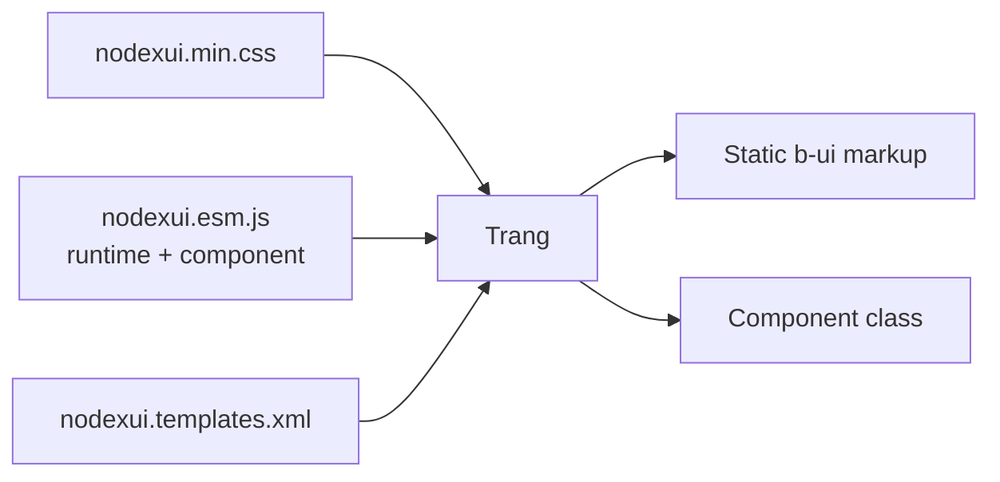

Tôi muốn có một thư viện UI có thể thả vào trang HTML thuần, trang website của Base HUB hoặc một app nhỏ, mà không cần bundler và không phải thêm một design system thứ hai. Tôi không tìm được thư viện nào hợp cả ba, nên tôi dùng Nodex UI. Đây là nó là gì và nó hạn chế ở đâu.

## Vì sao có Nodex UI

Bắt đầu từ bài toán. Một màn hình cần nút, ô nhập, dialog, bảng và một theme. Viết lại chúng cho mỗi dự án rất tốn thời gian. Dùng một thư viện lớn thì thường kéo theo công cụ build, router và một danh sách phụ thuộc dài.

Nhu cầu của tôi nhỏ và cụ thể:

- Trang phải chạy được từ static host, không cần build.
- Cùng một giao diện phải chạy được cả trong HTML thuần lẫn trong app.
- Theme sáng/tối và tiếng Việt/tiếng Anh phải dễ làm.
- Một AI agent phải dùng được mà không phải đoán.

Nodex UI xây trên Owl (một framework JavaScript nhỏ của Odoo) và Bootstrap 5. Màu sắc và kích thước theo token của shadcn/ui, nên giao diện gọn và trung tính. Một file CSS và một file JavaScript là đủ cho tất cả.

Tôi nghĩ điểm cuối cùng quan trọng nhất. Khi quy tắc được viết ra và cách cài chỉ là một file, cả người lẫn AI agent đều ít mắc lỗi hơn.

## Cách hoạt động

Có hai cách dùng. Cả hai đến từ cùng một package.

**Static markup.** Bạn thêm một attribute vào HTML bình thường. Script tìm attribute đó và biến nó thành component.

```html
<link rel="stylesheet" href="https://cdn.jsdelivr.net/npm/nodexui@1.3.5/dist/nodexui.min.css">
<script src="https://cdn.jsdelivr.net/npm/nodexui@1.3.5/dist/nodexui.min.js" defer></script>

<button b-ui="button" b-att-variant="default">Save</button>
<span b-icon="search"></span>
```

Khi trang tải xong, script quét `b-ui` và `b-icon` rồi mount chúng. Nếu bạn thêm markup về sau, hãy gọi `thebase.mountAll(root)`.

**Component class.** Với một app, bạn import component thật và dùng chúng như thẻ trong template Owl.

```js
import { Component, mount, xml, Button, Card, CardBody } from "nodexui";

const templates = await fetch(import.meta.resolve("nodexui/templates")).then((r) => r.text());

class Root extends Component {
  static template = xml`
    <Card><CardBody>
      <Button variant="'default'" label="'Save'"/>
    </CardBody></Card>`;
}

await mount(Root, document.getElementById("app"), { templates });
```



Hai quy tắc gây ra phần lớn lỗi, và tài liệu cũng nói rõ:

1. Nạp `nodexui.templates.xml` và truyền vào `mount()` trước khi bất kỳ component nào render.
2. Import từ `nodexui`, đừng bao giờ import từ `@odoo/owl`. Nếu không sẽ có hai bản `Component` và việc mount sẽ lỗi.

Hãy ghim phiên bản (pin version) khi chạy production. `@latest` có thể làm trang của bạn thay đổi ngay hôm có bản phát hành mới.

## Nó hỗ trợ gì

Theo tài liệu:

- **74 component**, mỗi cái đều có cả hai API: Button, Card, Dialog, Sheet, Tabs, Data Table, Date Picker, Combobox, Chart, Sidebar, Toast, Form field và nhiều nữa.
- **Icon:** toàn bộ bộ Lucide qua `b-icon`, không cần cài thêm.
- **Theme:** `b-theme="dark"`, hoặc `thebase.theme.set({ primary: "#0057d8" })`. Một theme riêng là hai file CSS nhỏ đổi các token như `--b-primary` và `--base-radius`.
- **Block:** các layout làm sẵn để copy, như dashboard, 16 biến thể sidebar, trang đăng nhập và đăng ký.
- **Component nội dung:** Markdown, trình soạn thảo rich-text, trình soạn code, DocViewer cho một thư mục Markdown, và ApiDoc cho một file OpenAPI.
- **Dịch vụ tuỳ chọn,** mỗi cái là một file nhỏ riêng: i18n (catalog `.po`), analytics không cookie, và QR kèm bộ dựng payload VietQR.
- **PWA toolkit:** tạo `manifest.webmanifest` và service worker, và tự tải lại các trang đang mở khi có bản deploy mới.

Không có trong danh sách: server-side rendering và UI native cho mobile. Với mobile, tài liệu mô tả cách bọc PWA bằng Capacitor.

## Dùng AI với Nodex UI

AI agent hay bịa ra những prop không tồn tại. Nodex UI xử lý việc này theo ba cách.

**1. Một skill.** Dự án có sẵn `base-ui-skill.zip`. Trong đó có `SKILL.md` và các trang tham chiếu với cú pháp đã được kiểm chứng, cùng các script để dựng dự án mới. Nó chỉ là Markdown và script thuần, nên không gắn với một công cụ nào.

| Agent | Đặt thư mục `base-ui/` vào |
| --- | --- |
| Claude Code | `~/.claude/skills` hoặc `.claude/skills` |
| Codex | `~/.codex/skills` hoặc `.codex/skills` |
| Gemini CLI | `~/.gemini/skills` hoặc `.gemini/skills` |

Với công cụ không có thư mục skills, như Cursor hay Copilot, hãy giải nén vào dự án và thêm một dòng vào `AGENTS.md`: "For any NodexUI work, read and follow `base-ui/SKILL.md` first."

**2. Câu lệnh đơn giản.** Sau khi cài, các yêu cầu ngắn sẽ kích hoạt skill:

| Nói | Kết quả |
| --- | --- |
| `create app` | Một PWA NodexUI mới |
| `use button` | Một component Button thật |
| `use search` | Một icon Lucide thật |
| `create electron app` | PWA cộng với vỏ Electron |
| `create capacitor app` | PWA cộng với vỏ Capacitor |

**3. Tài liệu viết cho agent.** Thư mục docs có một `index.md` đóng vai trò điểm vào duy nhất, theo kiểu `llms.txt`. Mỗi bản phát hành cũng công bố `nodexui.registry.json`, liệt kê prop, event và tên export của từng component. Agent đọc hợp đồng thay vì đoán.

Lời khuyên của tôi: đưa skill cho agent, và bảo nó mở trang tài liệu của component trước khi viết code. Tôi chưa đo xem cách này tiết kiệm được bao nhiêu thời gian. `[VERIFY]` hãy thêm một con số nếu bạn có.

## Một vài use case

Tôi chỉ liệt kê những gì tài liệu mô tả. `[VERIFY]` đánh dấu những cái bạn đã tự triển khai trước khi đăng.

- **Một trang website của Base HUB.** Trang không có runtime Nodex. Hai thẻ và markup `b-ui` cho nó giao diện giống phần còn lại của sản phẩm.
- **Một PWA nhỏ hoặc back office.** `create-nodexui-app` dựng sẵn cùng manifest và service worker. Vỏ Electron và Capacitor là tuỳ chọn.
- **Một trang tài liệu.** Trỏ DocViewer vào một thư mục Markdown và một `tree.json`. Một lệnh tạo ra cả hai.
- **Một cổng API.** Đưa cho ApiDoc một file OpenAPI 3. Nó hiển thị sidebar, schema, bảng Try It và hộp thoại Authorize.
- **Một màn hình thanh toán ở Việt Nam.** Dịch vụ QR dựng payload VietQR từ ngân hàng, số tài khoản và số tiền, rồi vẽ thành SVG. Tôi chưa chạy nó qua một luồng ngân hàng thật, nên hãy xem nó là công cụ hỗ trợ UI, không phải một đường thanh toán đã được chứng nhận.
- **Một dashboard.** Copy block `dashboard-01`, rồi thay dữ liệu.

## Khi nào nó không hợp

- Cộng đồng nhỏ. Ít hướng dẫn, ít câu trả lời trên mạng. Bạn phải đọc tài liệu.
- Template Owl là XML. Hỗ trợ TypeScript cho template còn hạn chế.
- Danh sách component ngắn hơn hệ sinh thái của React. Một số phần bạn phải tự làm.
- Import `nodexui` luôn chạy một lượt quét auto-mount, nên không có kiểu import không có side effect.
- Tôi chưa thử với bảng rất lớn hay một đội rất đông người.

Nếu bạn cần một UI không cần build mà cả người lẫn AI agent đều dùng đúng được, hãy bắt đầu với một file HTML và hai dòng CDN ở trên.
