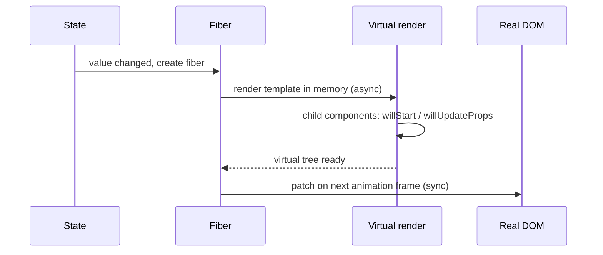

You change one value in your code and the screen updates. Nobody wrote the DOM code. I wanted to know what happens in between, so I read the Owl docs from the bottom up.

## The basic idea

A screen is a function of data. Owl keeps that idea in three steps:

1. You write a **component**: a class with a template and some state.
2. Owl turns the template into a function that builds a **virtual DOM**. That is a light copy of the page in memory.
3. When the state changes, Owl builds a new copy, compares it with the old one, and changes only the real DOM nodes that differ.

Everything else is detail on top of these three steps.

## 1. Components form a tree

An Owl app has one root component. A component can use other components in its template. Together they form a tree.

```js
class Task extends Component {
  static template = xml`<div t-esc="props.task.text"/>`;
  static props = ["task"];
}

class Root extends Component {
  static template = xml`
    <t t-foreach="tasks" t-as="task" t-key="task.id">
      <Task task="task"/>
    </t>`;
  static components = { Task };
}
```

A child receives data through **props**. The parent owns the data. The child reads it and does not own it.

## 2. State is watched through a proxy

A proxy is a JavaScript object that sits in front of another object and sees every read and write.

Owl's `reactive` function wraps your object in a proxy. The proxy records which keys are read. When one of those keys changes, it calls a callback.

`useState` is `reactive` with one fixed callback: re-render this component.

```js
setup() {
  this.state = useState({ value: 0 });
}
```

The template reads `state.value`, so Owl links the two. Later `state.value++` runs. The proxy sees the write and asks Owl to render this component again. A component that never read `value` is not touched.

This also works for nested objects. The proxy wraps what you read, one level at a time.

## 3. Templates are compiled in the browser

Owl templates are XML, written in a language called QWeb: `t-if`, `t-foreach`, `t-on-click`, `t-esc`. The browser already has an XML parser. Owl uses it to read the template, then generates a JavaScript render function.

So no build step is needed. A build step is still allowed. You can precompile templates if you want faster startup.

## 4. The lifecycle gives you hooks

Each component goes through fixed steps. Owl lets you run code at each one:

| Step | Hook | When |
| --- | --- | --- |
| setup | none | the component is created |
| willStart | `onWillStart` | async, before the first render |
| mounted | `onMounted` | after it is in the DOM |
| willUpdateProps | `onWillUpdateProps` | async, before new props apply |
| willPatch / patched | `onWillPatch` / `onPatched` | around each DOM update |
| willUnmount | `onWillUnmount` | before it leaves the DOM |
| willDestroy | `onWillDestroy` | before it is destroyed |

You call the hooks inside `setup`. Two of them can be `async`: `willStart` and `willUpdateProps`. That detail drives the render design.

## 5. A render has two phases



**Phase 1, virtual render.** Owl renders the template in memory. Each child is created (`willStart`) or updated (`willUpdateProps`). If a hook is async, Owl waits for it. The screen does not change yet.

**Phase 2, patch.** When the whole tree is ready, Owl applies it to the real DOM on the next animation frame. This step is synchronous.

A small object called a **fiber** tracks each render. A scheduler checks the fibers on every animation frame.

## 6. Why two phases matter

Many apps show a spinner at each async step. Owl does not. The old screen stays alive and working while the new one is built in memory. If the user does something else in the meantime, Owl can cancel the render, restart it, or reuse it.

Many state changes in one frame also give one patch, not many.

## Where it breaks

- Reactivity is explicit. If you use a plain object instead of `useState`, the screen will not update. That is the most common mistake in the Odoo tutorial too.
- Async hooks can add delay. The screen waits until the slowest child is ready.
- I have not benchmarked Owl against React or Vue. I am describing the design, not measured speed.

If you remember one thing: a proxy records what the template reads, and a two-phase render updates the page only when the next screen is ready.
