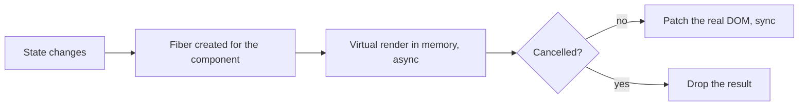

I keep hearing "Owl" when people talk about Odoo screens and about the UI I use. Most developers I meet know React and Vue, but not Owl. So: what is it, and why does it exist?

## Why it exists

Start with the problem. A web screen is a picture of some data. When the data changes, the picture must change too. Writing that by hand with `document.querySelector` gets messy fast.

A framework fixes this. You describe the screen once, from the data. The framework updates the page when the data changes.

Owl is one such framework. Odoo, the business software company, wrote it for its own web client ([source on GitHub](https://github.com/odoo/owl)). Odoo is very modular. Add-ons are installed and removed at any time. So Odoo does not know, before it runs, which files will load or what the screen will look like. A normal build toolchain does not fit well with that.

That one fact explains most of Owl's choices.

## What Owl is made of

Owl is one small package with five parts:

- **Virtual DOM.** A copy of the page kept in memory. Owl compares old and new copy, then changes only what differs.
- **Components.** Reusable pieces of screen, written as classes.
- **Template compiler.** Turns templates into render code. It runs in the browser.
- **Runtime.** Ties the parts together.
- **Reactivity.** Watches your state and re-renders when it changes.

## A first example

```js
import { Component, mount, useState, xml } from "owl";

class Counter extends Component {
  static template = xml`
    <button t-on-click="() => state.value++">
      Clicked <t t-esc="state.value"/> times
    </button>`;

  setup() {
    this.state = useState({ value: 0 });
  }
}

mount(Counter, document.body);
```

Read it from the top:

- `Counter` is a class. It extends `Component`.
- The template is XML. Owl calls this language QWeb. `t-on-click` handles a click. `t-esc` prints a value.
- `useState` wraps an object. Owl notes which keys the template reads. When one of them changes, only this component re-renders.

You change state by writing to it: `state.value++`. There is no setter function.

## The design choices

Odoo's documentation gives its own reasons. I found them clear, so here they are in short form.

**Classes, not only functions.** Many frameworks moved to function components. Owl keeps classes. Odoo uses inheritance to share code, and each method is a place where an add-on can patch behaviour.

**XML templates.** Odoo stores templates as XML in a database. That lets add-ons edit another template with XPath. So Owl keeps XML templates.

**No required tooling.** Owl compiles templates in the browser, using the browser's own XML parser. You can load it with one `<script>` tag. You can also use it inside a bundler. Both work.

**Explicit reactivity.** State is only watched when you wrap it in `useState` or `reactive`. A big internal object, such as a spreadsheet grid, can stay unwatched to save CPU and memory.

**Concurrent rendering.** Owl builds the next screen in memory first. It shows it when it is ready, and drops it if the user has moved on. No spinner for every small async step.

## How a render works



Rendering has two phases. The first builds the virtual tree and may be asynchronous. The second patches the real page and is synchronous. A scheduler checks every animation frame whether the work is done.

Since Owl 2, a child only re-renders when its props change (a simple equality check). If a prop is a reactive object, Owl still re-renders the children that read the changed key.

## Where it breaks

- **Ecosystem.** React and Vue have far more libraries, tutorials and developers. Owl has a small community. Hiring is harder.
- **Fit.** Owl was built for Odoo's needs. If your app is a normal single-page app with a normal build, React or Vue may be the safer choice.
- **Classes.** If your team likes hooks-only code, the class style will feel old.
- **Not tested by me.** I have used Owl through the Nodex UI component library, which builds on it. I have not run a large Owl app against heavy load.

## Try it

The quickest start is one HTML file. Load `owl.js` (the `.iife` build from the releases page), write a component, call `mount`. No install, no bundler.

Owl is a small framework for people who want classes, XML templates and no mandatory build step.
