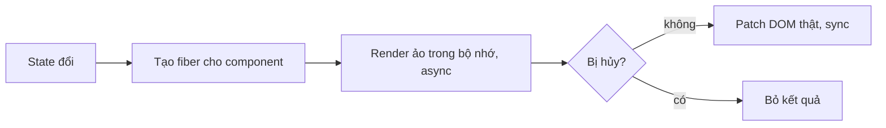

Tôi hay nghe nhắc đến "Owl" khi người ta nói về giao diện Odoo và giao diện tôi đang dùng. Hầu hết lập trình viên tôi gặp biết React và Vue, nhưng không biết Owl. Vậy Owl là gì, và vì sao nó tồn tại?

## Vì sao nó tồn tại

Bắt đầu từ vấn đề. Một màn hình web là hình ảnh của dữ liệu. Khi dữ liệu đổi, hình ảnh cũng phải đổi. Tự viết bằng `document.querySelector` sẽ nhanh chóng trở nên rối.

Framework giải quyết việc này. Bạn mô tả màn hình một lần, từ dữ liệu. Framework cập nhật trang khi dữ liệu thay đổi.

Owl là một framework như vậy. Odoo, công ty phần mềm doanh nghiệp, viết nó cho web client của chính họ ([mã nguồn trên GitHub](https://github.com/odoo/owl)). Odoo rất module hóa. Add-on được cài và gỡ bất cứ lúc nào. Vì vậy Odoo không biết trước khi chạy file nào sẽ được tải hay màn hình sẽ trông ra sao. Một chuỗi công cụ build thông thường không hợp với điều đó.

Chỉ một sự thật này giải thích phần lớn lựa chọn thiết kế của Owl.

## Owl gồm những phần nào

Owl là một gói nhỏ gồm năm phần:

- **Virtual DOM.** Một bản sao của trang giữ trong bộ nhớ. Owl so bản cũ với bản mới, rồi chỉ đổi phần khác nhau.
- **Component.** Các mảnh màn hình dùng lại được, viết dưới dạng class.
- **Template compiler.** Biến template thành code render. Nó chạy ngay trên trình duyệt.
- **Runtime.** Gắn các phần với nhau.
- **Reactivity.** Theo dõi state và render lại khi state đổi.

## Ví dụ đầu tiên

```js
import { Component, mount, useState, xml } from "owl";

class Counter extends Component {
  static template = xml`
    <button t-on-click="() => state.value++">
      Clicked <t t-esc="state.value"/> times
    </button>`;

  setup() {
    this.state = useState({ value: 0 });
  }
}

mount(Counter, document.body);
```

Đọc từ trên xuống:

- `Counter` là một class, kế thừa `Component`.
- Template là XML. Owl gọi ngôn ngữ này là QWeb. `t-on-click` xử lý click. `t-esc` in một giá trị.
- `useState` bọc một object. Owl ghi lại những key mà template đọc. Khi một key đổi, chỉ component này render lại.

Bạn đổi state bằng cách ghi trực tiếp: `state.value++`. Không có hàm setter.

## Các lựa chọn thiết kế

Tài liệu của Odoo nêu lý do riêng. Tôi thấy chúng rõ ràng, nên tóm tắt lại đây.

**Class, không chỉ hàm.** Nhiều framework đã chuyển sang function component. Owl giữ class. Odoo dùng kế thừa để chia sẻ code, và mỗi method là một chỗ để add-on vá hành vi.

**Template XML.** Odoo lưu template dạng XML trong database. Nhờ vậy add-on sửa template khác bằng XPath. Vì thế Owl giữ template XML.

**Không bắt buộc công cụ.** Owl biên dịch template ngay trên trình duyệt, bằng bộ phân tích XML có sẵn của trình duyệt. Bạn tải nó bằng một thẻ `<script>`. Bạn cũng có thể dùng trong bundler. Cả hai đều được.

**Reactivity tường minh.** State chỉ được theo dõi khi bạn bọc nó bằng `useState` hoặc `reactive`. Một object nội bộ lớn, như lưới bảng tính, có thể không bị theo dõi để tiết kiệm CPU và bộ nhớ.

**Render đồng thời.** Owl dựng màn hình kế tiếp trong bộ nhớ trước. Khi sẵn sàng mới hiển thị, và bỏ đi nếu người dùng đã chuyển sang việc khác. Không cần spinner cho mỗi bước async nhỏ.

## Một lần render diễn ra thế nào



Render có hai pha. Pha đầu dựng cây ảo và có thể bất đồng bộ. Pha sau patch trang thật và đồng bộ. Một scheduler kiểm tra mỗi animation frame xem việc đã xong chưa.

Từ Owl 2, component con chỉ render lại khi props đổi (so sánh bằng đơn giản). Nếu một prop là object reactive, Owl vẫn render lại những component con đọc key đã đổi.

## Khi nào nó không hợp

- **Hệ sinh thái.** React và Vue có nhiều thư viện, bài hướng dẫn và lập trình viên hơn hẳn. Owl có cộng đồng nhỏ. Tuyển người khó hơn.
- **Độ phù hợp.** Owl được xây cho nhu cầu của Odoo. Nếu app của bạn là single-page app bình thường với build bình thường, React hoặc Vue có thể an toàn hơn.
- **Class.** Nếu đội bạn thích code chỉ dùng hook, phong cách class sẽ thấy cũ.
- **Tôi chưa thử.** Tôi dùng Owl qua thư viện component Nodex UI, vốn xây trên Owl. Tôi chưa chạy một app Owl lớn dưới tải nặng.

## Thử ngay

Cách nhanh nhất là một file HTML. Tải `owl.js` (bản `.iife` từ trang releases), viết một component, gọi `mount`. Không cần cài đặt, không cần bundler.

Owl là framework nhỏ cho những ai muốn class, template XML và không bắt buộc bước build.
